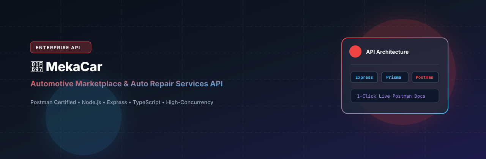
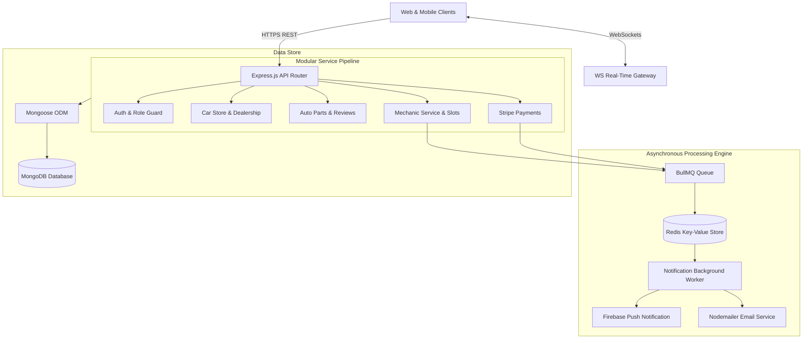

# Ayrton95 Backend (Mekacar Automotive Marketplace & Service Booking API)

<p align="center">
  
</p>

<p align="center">
  <a href="https://nodejs.org"></a>
  <a href="https://expressjs.com"></a>
  <a href="https://www.typescriptlang.org"></a>
  <a href="https://mongoosejs.com"></a>
  <a href="https://bullmq.io"></a>
  <a href="https://redis.io"></a>
  <a href="https://stripe.com"></a>
  <a href="LICENSE"></a>
</p>

---

## 📖 Overview

**Ayrton95 Backend (Mekacar API)** is an enterprise-grade automotive e-commerce and workshop service booking platform. Built with Express.js, TypeScript, Mongoose, and Redis/BullMQ, it orchestrates vehicle sales, auto parts inventory, mechanic service slot reservations, real-time customer-provider WebSockets messaging, automated background notification workers, and Stripe financial settlements.

---

## ⚡ Key Features

- **🚗 Dealership & Auto Parts Marketplace:** Comprehensive catalog management for vehicles, aftermarket parts, inventory levels, category taxonomies, and verified customer reviews.
- **🔧 Mechanic Service & Slot Scheduling:** Multi-step workshop appointment booking with dynamic time-slot allocation and availability management.
- **⚡ BullMQ Background Queue & Worker:** Dedicated notification worker process (`src/workers/notificationWorker.ts`) backed by Redis and Bull-Board dashboard for asynchronous queue processing.
- **💬 Real-Time WebSockets Messaging:** Low-latency bidirection room-based chat between vehicle buyers, sellers, and mechanic technicians.
- **💳 Stripe Payment Processing:** Secure checkout and webhook processing for vehicle down-payments, auto parts orders, and service deposits.
- **☁️ DigitalOcean Spaces Asset Delivery:** High-speed cloud asset storage with CDN distribution for vehicle galleries, product diagrams, and inspection invoices.

---

## 🏗️ System Architecture



---

## 🗂️ Project Structure

```
ayrton95_backend/
├── assets/
│   └── banner.svg                  # Repository banner
├── src/
│   ├── app/
│   │   ├── config/                 # Config loader & environment bindings
│   │   ├── middlewares/            # Auth, file upload, error handling
│   │   ├── modules/
│   │   │   ├── auth/               # User authentication & JWT
│   │   │   ├── carbook/            # Vehicle booking & transactions
│   │   │   ├── carstore/           # Vehicle catalog & inventory
│   │   │   ├── parts/              # Auto parts store
│   │   │   ├── partsbooking/       # Auto parts checkout
│   │   │   ├── service/            # Workshop mechanic services
│   │   │   ├── slots/              # Time-slot appointment availability
│   │   │   ├── socket/             # WebSockets server integration
│   │   │   └── user/               # User profile administration
│   │   ├── routes/                 # Central API route index
│   │   └── utils/                  # Spaces uploader, FCM, helpers
│   ├── workers/
│   │   └── notificationWorker.ts   # BullMQ background worker
│   ├── app.ts                      # Express app initialization
│   └── server.ts                   # HTTP & WebSocket server listener
├── package.json
└── tsconfig.json
```

---

## 🛠️ Tech Stack

| Technology | Purpose |
| :--- | :--- |
| **Node.js 20 & Express 4** | Core backend HTTP API runtime |
| **TypeScript 5.3** | Static typing and interface definitions |
| **Mongoose 8.4** | MongoDB object modeling and document validation |
| **BullMQ 5.58 & Redis** | Distributed message queues and background workers |
| **WebSockets (`ws`)** | Real-time chat and instantaneous customer support |
| **Stripe SDK 18** | Payment processing and billing webhooks |
| **DigitalOcean Spaces (AWS SDK v3)** | Cloud storage and asset CDN integration |
| **Nodemailer** | Transactional email dispatches |

---

## 🚀 Getting Started

### Prerequisites

- Node.js >= 20.0.0
- MongoDB instance (MongoDB 6+)
- Redis instance (Redis 6+)
- npm or yarn

### Installation

1. Clone the repository:
   ```bash
   git clone https://github.com/shahjalal-labs/ayrton95_backend.git
   cd ayrton95_backend
   ```

2. Install dependencies:
   ```bash
   npm install
   ```

3. Configure environment variables:
   ```bash
   cp .env.example .env
   ```
   Provide your MongoDB URI, Redis host/port, and Stripe/DigitalOcean credentials.

4. Start development server (runs both API and notification worker concurrently):
   ```bash
   npm run dev
   ```

5. Build and launch for production:
   ```bash
   npm run build
   npm start
   ```

---

## 📄 License

This project is licensed under the [ISC License](LICENSE).
